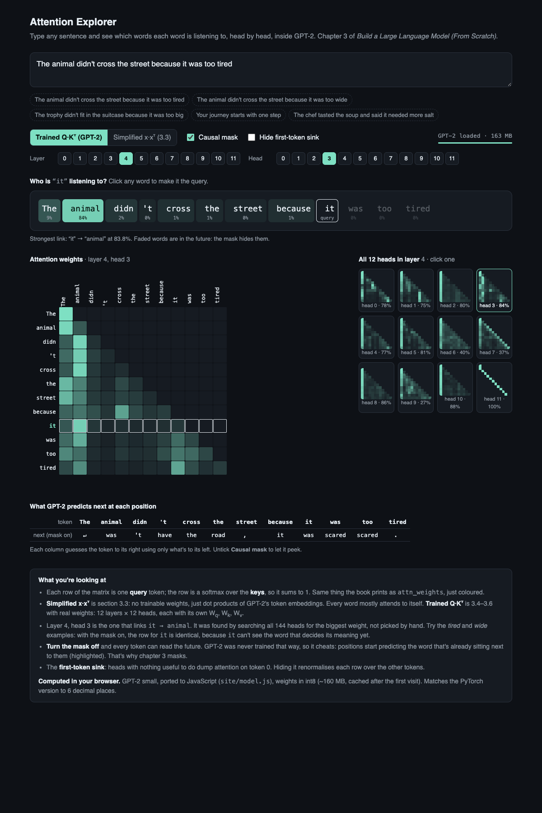

# attention-explorer

Chapter 3 of Sebastian Raschka's *Build a Large Language Model (From Scratch)*, as running code.
Simplified attention -> trainable Q/K/V -> causal mask -> multi-head, then the same class loaded with GPT-2's real weights
so you can watch heads that actually mean something.



**Live demo:** https://manyamkarthik.github.io/attention-explorer/

Type any sentence and see which words each word is listening to, head by head. In
*"The animal didn't cross the street because it was too tired"*, layer 4 head 3 sends 84% of `it`'s attention to `animal`.
Untick the causal mask and GPT-2 starts "predicting" the word it can already see.

```
uv sync
uv run python -m attention_explorer.simplified       # 3.3  softmax(inputs @ inputs.T), no weights
uv run python -m attention_explorer.self_attention   # 3.4  W_q, W_k, W_v: v1 (Parameter) vs v2 (Linear), same output
uv run python -m attention_explorer.causal           # 3.5  the mask, dropout, and what breaks without the mask
uv run python -m attention_explorer.multihead        # 3.6  wrapper vs split-into-heads MultiHeadAttention
uv run python -m attention_explorer.gpt2             # the chapter's MultiHeadAttention + GPT-2's trained weights
uv run python -m attention_explorer.heatmap --layer 4 --head 3     # heatmap PNG (drop --head for all 12, add --no-mask)
uv run python demo/server.py                         # the demo page, backed by PyTorch, at http://localhost:8000
```

| file | what it does |
| --- | --- |
| `simplified.py` | attention scores as plain dot products, the book's "Your journey starts with one step" example |
| `self_attention.py` | `SelfAttention_v1` / `v2`, scaled dot-product, proof they compute the same thing |
| `causal.py` | `CausalAttention` with mask + dropout, and a peek test: change the last word, see which outputs move |
| `multihead.py` | `MultiHeadAttentionWrapper` and `MultiHeadAttention` (one matmul, reshape into heads, `out_proj`) |
| `gpt2.py` | GPT-2 small built around that `MultiHeadAttention`, weights from Hugging Face. Finds the head that links two words |
| `heatmap.py` | matplotlib heatmaps, one head or a whole layer |
| `site/` | the playground. `model.js` is GPT-2 ported to JavaScript so it runs on GitHub Pages with no server |
| `scripts/export_weights.py` | GPT-2 -> int8 files for the browser (~160 MB), checked against full precision |
| `scripts/check_js.js` | runs the JS model in node and compares it to PyTorch |

## Things worth noticing

- **The peek test** (`causal.py`): with the mask, changing the last word moves earlier outputs by exactly 0. Without it, every
  output changes. That's the whole reason for the mask.
- **"tired" vs "wide"**: with the mask on, `it`'s attention row is identical in both sentences, because `it` can't see the word
  that decides what it refers to yet.
- **Mask off on a trained model**: GPT-2 switches `the -> road` to `the -> street`, `street -> ,` to `street -> because`.
  It isn't smarter, it just reads the answer.
- **Random vs trained weights**: the chapter's classes start random, so their heatmaps are noise. Meaningful patterns come from
  training, which is why the playground uses GPT-2's weights in the same attention code.

## How the browser version stays honest

GitHub can't run Python, so `site/model.js` reimplements the forward pass. Weights are int8 with one scale per row (token
embedding in fp16, since it doubles as the output layer). `check_js.js` runs on every deploy: attention matches the
PyTorch model on the same weights to ~1e-6 and the next-token guesses are identical. Against full fp32 GPT-2, attention differs
by at most ~0.05.

## Hosting on GitHub Pages

1. Push to GitHub (branch `main`).
2. Repo **Settings -> Pages -> Source: GitHub Actions**.
3. `.github/workflows/pages.yml` downloads GPT-2, builds `site/weights/`, checks the JS model, and deploys `site/`.
